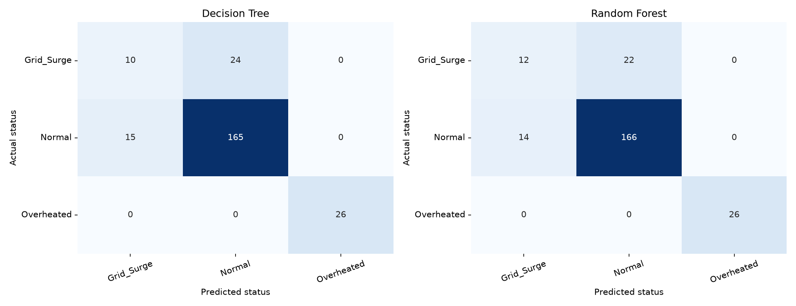

# EV Campus Analytics

[Live application](https://s1-pop-assessment2-jsdhilgeqw6duwytp6qvaf.streamlit.app/) · [中文说明](README.zh-CN.md)

EV Campus Analytics is a data analysis and machine learning application developed for Taylor's **Principles of Programming — Assessment 2** group project. It uses 1,200 lecturer-supplied charging sessions to help campus facility engineers explore charging patterns, compare peak and off-peak usage, and estimate the operational status of a charging session.

The project extends the charging-fee work from Assessment 1 into a workflow covering data preparation, model comparison, a bilingual web interface, and cloud deployment. Predictions use manually entered session details; the application is not connected to live chargers or sensors.

## What the system does

| Module | Main functions |
| --- | --- |
| **Executive KPI Dashboard** | Total energy, average charging duration, estimated peak revenue, optional carbon savings, a filtered records table, and CSV download. |
| **Visual Analytics Studio** | Energy versus battery temperature, AC/DC session distribution, and average energy during peak and off-peak periods. All three charts follow the selected filters. |
| **Live ML Prediction** | A sidebar form predicts `Normal`, `Grid_Surge`, or `Overheated`, with a colour-coded result, calculated power, and peak/off-peak status. |

The dashboard and charts can be filtered by charger type, user type, charging period, and minimum energy. The top-right language selector switches the interface between English and Chinese. Downloads retain the original column names and category codes.

Optional settings accept a net carbon savings factor and a temperature alert threshold. No values are assumed by default. Operation logs beginning with `[TASK3]` record page changes, filters, chart rendering, download requests, and submitted predictions in the console or cloud logs.

## How the project was developed

### 1. Prepare the charging data

The supplied dataset contains AC/DC chargers, Staff/Student/Visitor users, charging measurements, and grid-status labels. Its temperature field is `Battery_Temp_C`, which is used throughout this implementation.

The Pandas/NumPy pipeline checks missing values and duplicate session IDs, fills numeric missing values with column medians, validates measurements, and calculates:

- `Power_kW = Energy_kWh / (Duration_Mins / 60)`.
- `Peak_Hour_Flag`: whether the session overlaps **12:00–17:00**, using the start hour and duration.

During initial cleaning, **25 missing durations** were filled with **97 minutes**, and **35 missing energy values** with **13.28 kWh**. No duplicate sessions were found, so all 1,200 records were retained. The pipeline also prints mean energy and battery temperature by charger type, peak flag, and their combination.

The repository's `0_ev_campus_dataset.csv` is the **processed working dataset**, with 11 columns. The `0_` prefix identifies the data file; it does not mean an untouched source copy. Running Task 1 updates this same file. Existing AC/DC charger groups are retained; a separate energy-efficiency classification has not been implemented.

### 2. Train and compare two models

The training script predicts `Grid_Status_Label` from nine inputs: charger type, user type, start hour, duration, energy, overstay, battery temperature, power, and peak flag. Session IDs and target labels are excluded from the inputs.

It uses a stratified **80/20 split**: **960 training records** and **240 test records**, with `random_state=42`. Charger and user types are one-hot encoded, and test columns are aligned with the training columns. A Decision Tree and a Random Forest with 100 trees are evaluated on the same test set.

| Model | Accuracy | Macro precision | Macro recall | Macro F1 |
| --- | --- | --- | --- | --- |
| **Random Forest** | **85.00%** | **0.7815** | **0.7584** | **0.7674** |
| Decision Tree | 83.75% | 0.7577 | 0.7369 | 0.7444 |

Macro metrics give each status equal weight. The script selects the highest macro F1, using accuracy to break a tie. **Random Forest was selected** and saved with its input and encoding information. The Decision Tree is evaluated in memory and is not exported. The saved model retains the evaluated training fit; it is not retrained on the test set.



The data is imbalanced: 898 `Normal`, 172 `Grid_Surge`, and 130 `Overheated` sessions. `Grid_Surge` remains the weakest prediction class. These scores describe this dataset and split, rather than guaranteed performance on new charging systems. Numeric medians were calculated before the split in Task 1, so this workflow is not a fully isolated train-only preprocessing evaluation.

### 3. Build and refine the web application

The Streamlit app connects the prepared data and saved model to three sidebar pages. Data and model loading are cached; predictions reuse the saved model instead of retraining it on each page interaction.

Development then added bilingual labels, filtered CSV downloads, optional analysis settings, and operation logs. Matplotlib's **Agg** backend resolved the macOS worker-thread plotting error. The app selects an available Chinese font for translated charts, and it supports both the Streamlit terminal command and PyCharm's normal **Run** action.

Local checks covered both languages, three charts, filtering and empty selections, the download callback, model loading, and submitted predictions. These checks do not replace a complete test of the deployed application.

### 4. Publish to GitHub and deploy to the cloud

The project was uploaded to the group's [GitHub repository](https://github.com/taylors-0395483/s1-pop-assessment2). Python dependencies were pinned to match the model environment, and `packages.txt` was added to install the **WenQuanYi Zen Hei** Chinese font on Linux.

Deployment uses **Streamlit Community Cloud**, branch `main`, entry file `task3_app.py`, and Python **3.12**. The repository's GitHub organization required separate OAuth approval for Streamlit before deployment could proceed. After authorization, the application was deployed at the live link above.

The cloud runs the app using the included CSV and model; it does not execute the cleaning or training scripts at startup. Application code and dependency updates pushed to the deployment branch are picked up by Community Cloud. README updates document the project without changing its analysis or predictions.

## Technology and files

**Python 3.12** · Pandas / NumPy · Scikit-learn / Joblib · Matplotlib / Seaborn · Streamlit · GitHub · Streamlit Community Cloud

| File | Role |
| --- | --- |
| `0_ev_campus_dataset.csv` | Processed working data, including power and peak-hour features. |
| `task1_data_pipeline.py` | Cleaning, validation, feature calculation, and grouped statistics. |
| `task2_train_model.py` | Encoding, training, model comparison, evaluation, and export. |
| `task2_ev_model.pkl` | Selected Random Forest and prediction metadata, saved with Joblib. |
| `task2_model_comparison.csv` | Scores for both classifiers. |
| `task2_confusion_matrices.png` | Test-set confusion matrices. |
| `task3_app.py` | Bilingual dashboard, charts, and prediction interface. |
| `requirements.txt` | Pinned Python dependencies. |
| `packages.txt` | Linux font dependency for cloud charts. |

Task prefixes distinguish scripts and outputs. This repository uses those filenames in place of the generic filenames in the assessment brief.

## Run locally

In the project directory, using Python 3.12:

```bash
python -m pip install -r requirements.txt
python -m streamlit run task3_app.py
```

Open the URL printed in the terminal; press `Ctrl+C` to stop. In PyCharm, select the environment with these dependencies and run `task3_app.py` as a normal Python script.

The prepared data and model are included. To regenerate them, run the following in order:

```bash
python task1_data_pipeline.py
python task2_train_model.py
```

Task 1 overwrites the working CSV, and Task 2 overwrites its three output files. Restart the app after replacing data or the model to refresh its cache.

## Interpretation and current status

Peak revenue is an **estimate**, using Assessment 1 hourly tiers, rounded-up charging hours, fee caps, Staff/Student discounts, a peak surcharge, and an overstay surcharge. It sums the estimated full-session fees for sessions that overlap the peak period. Fields for first-time waivers, Eco-Pass discounts, and RFID replacement fees are unavailable and are excluded. Carbon savings depend on the factor entered by the user; KPI deltas compare the filtered data with the full dataset, not a previous date.

The core pipeline, model comparison, web interface, GitHub upload, and initial cloud deployment are in place. A full cloud feature check and the five-minute demonstration video remain to be completed.
